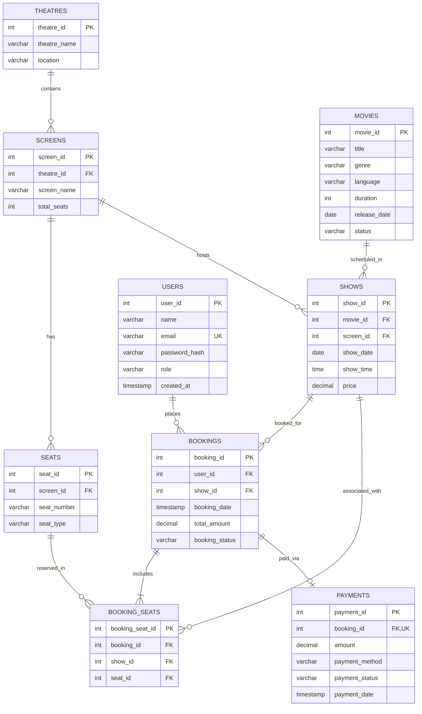

# MovieBook: Database Design & Data Dictionary

---

### 1. Entity-Relationship (ER) Diagram

The following Mermaid diagram illustrates the actual entities, attributes, primary keys, foreign keys, and cardinalities implemented in MySQL (`movie_booking_db`).



---

### 2. Relational Schema Representation

- **users** (<ins>user_id</ins>, name, email, password_hash, role, created_at)
- **movies** (<ins>movie_id</ins>, title, genre, language, duration, release_date, status)
- **theatres** (<ins>theatre_id</ins>, theatre_name, location)
- **screens** (<ins>screen_id</ins>, *theatre_id*, screen_name, total_seats)
  - Foreign Key: `theatre_id` references `theatres(theatre_id)`
- **seats** (<ins>seat_id</ins>, *screen_id*, seat_number, seat_type)
  - Foreign Key: `screen_id` references `screens(screen_id)`
- **shows** (<ins>show_id</ins>, *movie_id*, *screen_id*, show_date, show_time, price)
  - Foreign Key: `movie_id` references `movies(movie_id)`
  - Foreign Key: `screen_id` references `screens(screen_id)`
- **bookings** (<ins>booking_id</ins>, *user_id*, *show_id*, booking_date, total_amount, booking_status)
  - Foreign Key: `user_id` references `users(user_id)`
  - Foreign Key: `show_id` references `shows(show_id)`
- **booking_seats** (<ins>booking_seat_id</ins>, *booking_id*, *show_id*, *seat_id*)
  - Foreign Key: `booking_id` references `bookings(booking_id)`
  - Foreign Key: `show_id` references `shows(show_id)`
  - Foreign Key: `seat_id` references `seats(seat_id)`
- **payments** (<ins>payment_id</ins>, *booking_id*, amount, payment_method, payment_status, payment_date)
  - Foreign Key: `booking_id` references `bookings(booking_id)` (Unique constraint enforces 1-to-1 relationship)

---

### 3. Data Dictionary

#### 3.1 Table: `users`
| Column Name | Data Type | Nullable | Key | Default | Description |
|---|---|---|---|---|---|
| `user_id` | INT | NO | PRI | auto_increment | Unique identifier for registered user |
| `name` | VARCHAR(100) | NO | | NULL | Full name of the patron or administrator |
| `email` | VARCHAR(100) | NO | UNI | NULL | Unique email address for login/identification |
| `password_hash` | VARCHAR(255) | NO | | NULL | Secure hash string of user password |
| `role` | VARCHAR(20) | NO | | NULL | Role classification (`CUSTOMER`, `ADMIN`) |
| `created_at` | TIMESTAMP | YES | | CURRENT_TIMESTAMP | Registration timestamp |

#### 3.2 Table: `movies`
| Column Name | Data Type | Nullable | Key | Default | Description |
|---|---|---|---|---|---|
| `movie_id` | INT | NO | PRI | auto_increment | Primary key for movie record |
| `title` | VARCHAR(150) | NO | MUL | NULL | Title of the film (indexed) |
| `genre` | VARCHAR(100) | NO | | NULL | Movie category (Action, Romance, Thriller) |
| `language` | VARCHAR(50) | NO | | NULL | Primary spoken audio track |
| `duration` | INT | NO | | NULL | Movie runtime in minutes |
| `release_date` | DATE | NO | | NULL | Theatrical debut date |
| `status` | VARCHAR(20) | YES | | 'ACTIVE' | Screening availability (`ACTIVE`, `INACTIVE`) |

#### 3.3 Table: `theatres`
| Column Name | Data Type | Nullable | Key | Default | Description |
|---|---|---|---|---|---|
| `theatre_id` | INT | NO | PRI | auto_increment | Unique theatre complex ID |
| `theatre_name` | VARCHAR(150) | NO | | NULL | Commercial name of the multiplex |
| `location` | VARCHAR(200) | NO | | NULL | City / metropolitan area (Bengaluru, Mysuru, Hubballi) |

#### 3.4 Table: `screens`
| Column Name | Data Type | Nullable | Key | Default | Description |
|---|---|---|---|---|---|
| `screen_id` | INT | NO | PRI | auto_increment | Unique identifier for cinema auditorium |
| `theatre_id` | INT | NO | MUL | NULL | Parent theatre reference |
| `screen_name` | VARCHAR(50) | NO | | NULL | Hall name (Screen 1, Screen 2) |
| `total_seats` | INT | NO | | NULL | Total physical seat capacity |

#### 3.5 Table: `seats`
| Column Name | Data Type | Nullable | Key | Default | Description |
|---|---|---|---|---|---|
| `seat_id` | INT | NO | PRI | auto_increment | Unique identifier for physical seat |
| `screen_id` | INT | NO | MUL | NULL | Screen where the seat is physically located |
| `seat_number` | VARCHAR(10) | NO | | NULL | Alphanumeric row/seat identifier (A1, A2, B1...) |
| `seat_type` | VARCHAR(20) | YES | | 'REGULAR' | Seating class tier (`REGULAR`, `PREMIUM`) |

#### 3.6 Table: `shows`
| Column Name | Data Type | Nullable | Key | Default | Description |
|---|---|---|---|---|---|
| `show_id` | INT | NO | PRI | auto_increment | Unique screening schedule ID |
| `movie_id` | INT | NO | MUL | NULL | Movie scheduled for presentation |
| `screen_id` | INT | NO | MUL | NULL | Screen hosting the screening |
| `show_date` | DATE | NO | MUL | NULL | Scheduled screening calendar date |
| `show_time` | TIME | NO | | NULL | Scheduled screening start time |
| `price` | DECIMAL(10,2)| NO | | NULL | Base ticket admission fee in INR |

#### 3.7 Table: `bookings`
| Column Name | Data Type | Nullable | Key | Default | Description |
|---|---|---|---|---|---|
| `booking_id` | INT | NO | PRI | auto_increment | Unique reservation transaction ID |
| `user_id` | INT | NO | MUL | NULL | Patron who initiated booking |
| `show_id` | INT | NO | MUL | NULL | Show for which tickets are reserved |
| `booking_date`| TIMESTAMP | YES | | CURRENT_TIMESTAMP | Timestamp when transaction was created |
| `total_amount`| DECIMAL(10,2)| NO | | NULL | Server-computed total ticket cost |
| `booking_status`| VARCHAR(20) | YES | | 'CONFIRMED' | Booking lifecycle (`CONFIRMED`, `CANCELLED`)|

#### 3.8 Table: `booking_seats`
| Column Name | Data Type | Nullable | Key | Default | Description |
|---|---|---|---|---|---|
| `booking_seat_id`| INT | NO | PRI | auto_increment| Junction record primary key |
| `booking_id` | INT | NO | MUL | NULL | Parent booking transaction |
| `show_id` | INT | NO | MUL | NULL | Redundant foreign key for rapid conflict checking |
| `seat_id` | INT | NO | MUL | NULL | Physical seat reserved |

#### 3.9 Table: `payments`
| Column Name | Data Type | Nullable | Key | Default | Description |
|---|---|---|---|---|---|
| `payment_id` | INT | NO | PRI | auto_increment | Unique payment ledger record |
| `booking_id` | INT | NO | UNI | NULL | Unique booking reference (1:1 constraint) |
| `amount` | DECIMAL(10,2)| NO | | NULL | Transaction monetary sum |
| `payment_method`| VARCHAR(30) | NO | | NULL | Payment instrument (`UPI`, `CARD`, `UPI (DEMO)`)|
| `payment_status`| VARCHAR(20) | NO | MUL | NULL | Settlement state (`SUCCESS`, `FAILED`) |
| `payment_date`| TIMESTAMP | YES | | CURRENT_TIMESTAMP | Payment settlement timestamp |

---

### 4. Keys, Constraints, Indexes & Advanced DB Objects

#### 4.1 Primary & Foreign Keys
- **Primary Keys**: Every table uses an auto-increment integer `PRIMARY KEY` to guarantee uniqueness and efficient B-Tree indexing.
- **Foreign Keys with Referential Integrity**:
  - `screens.theatre_id` -> `theatres.theatre_id`
  - `seats.screen_id` -> `screens.screen_id`
  - `shows.movie_id` -> `movies.movie_id`
  - `shows.screen_id` -> `screens.screen_id`
  - `bookings.user_id` -> `users.user_id`
  - `bookings.show_id` -> `shows.show_id`
  - `booking_seats.booking_id` -> `bookings.booking_id`
  - `booking_seats.show_id` -> `shows.show_id`
  - `booking_seats.seat_id` -> `seats.seat_id`
  - `payments.booking_id` -> `bookings.booking_id` (with `UNIQUE` constraint)

#### 4.2 Composite & Secondary Indexes
The database features dedicated indexes to accelerate lookups:
1. `idx_movie_title` on `movies(title)`: Accelerates movie searching.
2. `idx_show_movie` on `shows(movie_id)`: Speeds up finding shows for a movie.
3. `idx_shows_date_time` on `shows(show_date, show_time)`: Optimizes schedule lookups.
4. `uq_shows_screen_date_time` on `shows(screen_id, show_date, show_time)`: Prevents overlapping shows on the same screen at the same time.
5. `idx_booking_user` on `bookings(user_id)`: Speeds up retrieving user order histories.
6. `idx_booking_show` on `bookings(show_id)`: Quick retrieval of all bookings for a show.
7. `idx_payment_status` on `payments(payment_status)`: Optimizes payment reconciliation queries.

#### 4.3 Database Views
Five views simplify complex multi-table joins for analytical reports:
1. **`movie_show_details`**: Joins `shows`, `movies`, `screens`, and `theatres` to provide a consolidated schedule with pricing and location.
2. **`booking_summary`**: Joins `bookings`, `users`, `shows`, `movies`, `screens`, and `theatres` to produce complete customer order records.
3. **`payment_report`**: Joins `payments`, `bookings`, `users`, `shows`, and `movies` to report monetary flows and payment instruments.
4. **`booking_details`**: Provides detailed breakdown of individual booked seats joined with booking amounts.
5. **`show_schedule`**: Displays chronologically ordered upcoming showtimes.

#### 4.4 Triggers & Stored Procedures
- **Trigger `check_booking_amount`** (defined in `movie_booking_project.sql`):
  ```sql
  CREATE TRIGGER check_booking_amount
  BEFORE INSERT ON bookings
  FOR EACH ROW
  BEGIN
      IF NEW.total_amount <= 0 THEN
          SIGNAL SQLSTATE '45000'
          SET MESSAGE_TEXT = 'Booking amount must be greater than zero';
      END IF;
  END;
  ```
  *Purpose*: Enforces business rule validation at the database engine level, rejecting non-positive transaction amounts.
- **Stored Procedure `GetShowsByDate`** (defined in `10_get_shows_by_date_procedure.sql`):
  ```sql
  CREATE PROCEDURE GetShowsByDate(IN p_show_date DATE)
  BEGIN
      SELECT s.show_id, m.title AS movie_title, t.theatre_name,
             s.show_date, s.show_time, s.price
      FROM shows s
      JOIN movies m ON s.movie_id = m.movie_id
      JOIN screens sc ON s.screen_id = sc.screen_id
      JOIN theatres t ON sc.theatre_id = t.theatre_id
      WHERE s.show_date = p_show_date
      ORDER BY s.show_time;
  END;
  ```
  *Purpose*: Encapsulates parameterized daily show querying inside a reusable stored routine.
