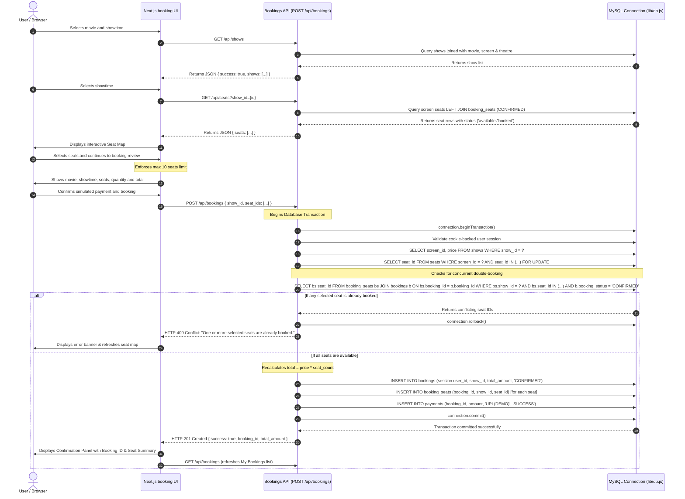

# MovieBook: System Architecture & Workflows

---

### 1. High-Level System Architecture

The MovieBook system employs a modern 3-tier architecture:

```mermaid
graph TD
    subgraph Client Tier [Presentation Tier - Browser]
        UI[Next.js React Client]
        Components[Movie Cards | Seat Map | Booking Form | My Bookings]
    end

    subgraph Application Tier [Server / API Tier - Next.js App Router]
        Router[Next.js Server Routes]
        API_Movies["/api/movies"]
        API_Shows["/api/shows"]
        API_Seats["/api/seats"]
        API_Bookings["/api/bookings"]
        API_Auth["/api/auth/*"]
        API_Watchlist["/api/watchlist"]
        API_Recommendations["/api/recommendations"]
        DB_Pool["lib/db.js (mysql2 connection pool)"]
        Neo4jDriver["lib/neo4j.js (Neo4j driver)"]
    end

    subgraph mysqlTier["MySQL - Relational Database"]
        MySQL[(movie_booking_db)]
        Tables[(Core tables + user_sessions + movie_watchlist)]
        Views[(movie_show_details, booking_summary, payment_report)]
        Triggers[(check_booking_amount)]
    end
    subgraph graphTier["Neo4j Desktop - Graph Database"]
        Neo4j[(MovieBookDB / neo4j)]
    end

    UI --> Router
    Router --> API_Movies
    Router --> API_Shows
    Router --> API_Seats
    Router --> API_Bookings
    Router --> API_Auth
    Router --> API_Watchlist
    Router --> API_Recommendations
    API_Movies --> DB_Pool
    API_Shows --> DB_Pool
    API_Seats --> DB_Pool
    API_Bookings --> DB_Pool
    API_Auth --> DB_Pool
    API_Watchlist --> DB_Pool
    API_Recommendations --> DB_Pool
    API_Recommendations --> Neo4jDriver
    DB_Pool --> MySQL
    Neo4jDriver --> Neo4j
    API_Recommendations --> MySQL
    MySQL --- Tables
    MySQL --- Views
    MySQL --- Triggers
```

1. **Client Tier**: Multi-page Next.js App Router UI, styled with `app/globals.css`. Client components handle discovery controls, seat selection, and the booking-review step; protected page routes and API handlers validate the customer session server-side.
2. **Application Tier**: Next.js Node.js route handlers use `mysql2/promise` (`lib/db.js`) for transactional relational operations and `neo4j-driver` (`lib/neo4j.js`) for graph suggestions. Booking ownership comes from the authenticated session, not a client-supplied user ID or a first-row fallback.
3. **Storage Tier**: MySQL is authoritative for customers, movies, shows, seats, bookings, simulated payments, sessions, and Watchlists. Neo4j provides recommendation relationships; recommendation availability does not gate MySQL booking operations.

---

### 2. End-to-End Booking Sequence & Concurrency Control

The sequence diagram below details the entire transactional booking flow, including seat locking, conflict detection, price computation, and payment recording.



---

### 3. Key Defensive Programming Controls

1. **Row-Level Locking (`FOR UPDATE`)**: Prevents race conditions where two simultaneous transactions inspect the seat list before either has inserted a record.
2. **Server-Side Trust Boundary**: Total booking price is computed using the price fetched directly from the database row (`show.price`), completely ignoring any client manipulation.
3. **Foreign Key Screening**: The API checks that every requested `seat_id` physically belongs to the screen linked to the chosen `show_id`, preventing invalid seat injection across screens.
4. **Graceful State Synchronization**: If a conflict occurs (HTTP 409), the client immediately re-fetches the seat map, deselects invalid seats, and notifies the patron without crashing the application.
